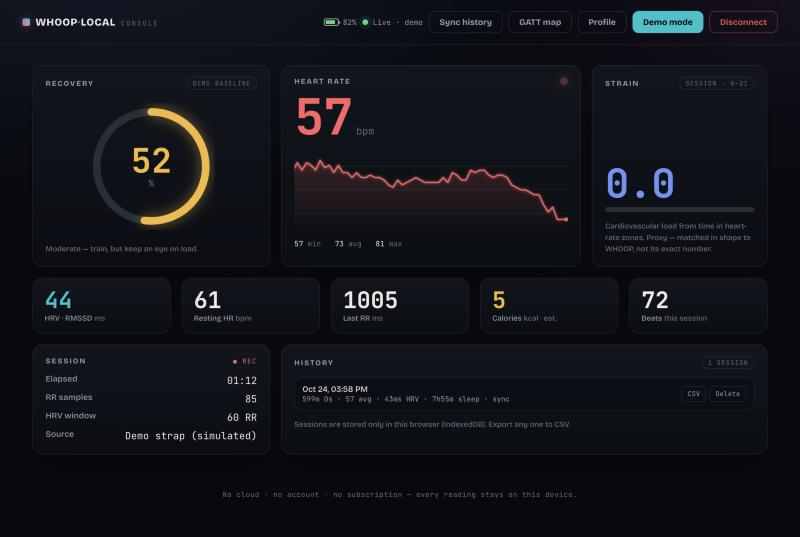

# WHOOP Local

**Use a WHOOP 4.0 strap with no subscription.** Read its data directly over Bluetooth, compute HRV / recovery / strain / sleep on-device, and keep everything local. No cloud, no account, no membership.



> It's your hardware on your wrist. Cancel the membership and the band keeps recording to its own flash — WHOOP's cloud just stops showing it to you. WHOOP Local talks to the strap directly and bypasses the cloud entirely.

Not affiliated with or endorsed by WHOOP. This is interoperability with a device you own, built on the open-source reverse-engineering community (credits below).

---

## What it does

- **Live vitals** — real-time heart rate, RR-intervals, and instant HRV straight off the strap.
- **Metrics engine** — HRV (RMSSD / SDNN / pNN50) with Malik artifact filtering, resting HR, recovery, strain, and calories.
- **Sleep detection** — segments the overnight sleep window from the heart-rate time series, and computes recovery from *that* window.
- **History drain** — pulls the 1 Hz records the band recorded to flash (even with nothing connected) over the proprietary channel.
- **Local-first dashboard** — a dark "instrument cluster" UI with a live canvas trace, recovery ring, session history (IndexedDB), and CSV export. Vanilla JS, zero runtime dependencies.
- **Demo mode** — the whole app runs with simulated data, so you can try it without a band.

## How the strap exposes data

| Path | BLE service | Needs | Powers |
|------|-------------|-------|--------|
| **Live** | Standard Heart Rate `0x180D` / `0x2A37` | nothing — open, no pairing | Live HR + RR → live HRV, strain, calories |
| **History** | Proprietary WHOOP `6108…` service | command frames + CRC + sync handshake | Draining recorded flash → overnight recovery, sleep |

The live path is a **standard Bluetooth service** — readable in any Chromium browser via Web Bluetooth, no bonding required. The history path is the real reverse-engineering: a custom frame envelope, WHOOP's CRC variant, and a sync state machine.

## Architecture

```
src/whoop/            Pure, dependency-free codec + metrics (runs in browser AND Node tests)
  crc.js              CRC-8 (frame header) + zlib CRC-32 (payload)
  framing.js          Frame envelope + length-based reassembler
  protocol.js         GATT UUIDs, command builders, 96-byte record decoder, sync handshake
  metrics.js          HRV, recovery, strain, resting HR, calories (Keytel + Mifflin–St Jeor)
  sleep.js            Overnight sleep-window detection

dashboard/            Local-first web app (vanilla JS, no framework)
  index.html app.js   UI + orchestration
  ble.js              Web Bluetooth source (+ demo source)
  sync.js             History flash-drain engine
  charts.js store.js  Canvas HR trace + IndexedDB persistence / CSV export

serve.py              Tiny no-cache static dev server (run from repo root)
phase1/               Minimal single-file connection + live-vitals harness
test/                 53 unit tests (node --test)
```

## Engineering notes

- **The frame reassembler is length-based, not "reset on `0xAA`"** — sensor payloads contain the start-of-frame byte, so naive splitting silently corrupts frames.
- **The CRC is cross-checked against Node's `zlib.crc32`** in the test suite — an independent oracle beats "looks right."
- **Recovery and strain are published sports-science approximations** (log-RMSSD z-score; HR-reserve load), clearly labeled — *not* WHOOP's proprietary algorithms. Raw SpO₂/temperature are uncalibrated relative ADCs, surfaced as trends only.
- **Verified against real hardware** for the live path, which exposed bugs clean demo data hid (HR = 0 on optical contact-loss; RR artifacts inflating HRV) — now filtered.

## Run it

Needs **desktop Chrome or Edge** (Web Bluetooth) and a secure context (`localhost` or `https://`).

```bash
python3 serve.py 8778
# open http://localhost:8778/dashboard/ in Chrome
```

Click **Demo mode** to explore with simulated data, or **Connect strap** to use a real band. Before connecting a real strap: quit the official WHOOP app (the band allows one BLE connection at a time) and keep it snug on-wrist.

### Tests

```bash
npm test   # node --test — fully offline, 53 tests
```

## Status

- ✅ Live HR / RR / HRV — **validated on real hardware**
- ✅ Protocol codec, metrics engine, sleep detection — built + unit-tested
- ✅ History-drain engine — built + validated offline (UUID-agnostic: routes by packet type)
- ⏳ History drain on real hardware — the BLE handshake is pending on-device validation

## Credits

Built on the open-source WHOOP reverse-engineering community:
- [OpenStrap](https://github.com/OpenStrap) — hardware-verified protocol reference
- [christianmeurer/whoop-reader](https://github.com/christianmeurer/whoop-reader) — Python frame + packet parser
- [scandolo/openwhoop](https://github.com/scandolo/openwhoop) — Rust BLE protocol + algorithms

## Disclaimer

For personal use and interoperability with a device you own. Not a medical device — all metrics are estimates. "WHOOP" is a trademark of its respective owner; this project is independent and unaffiliated.

## License

MIT — see [LICENSE](LICENSE).
